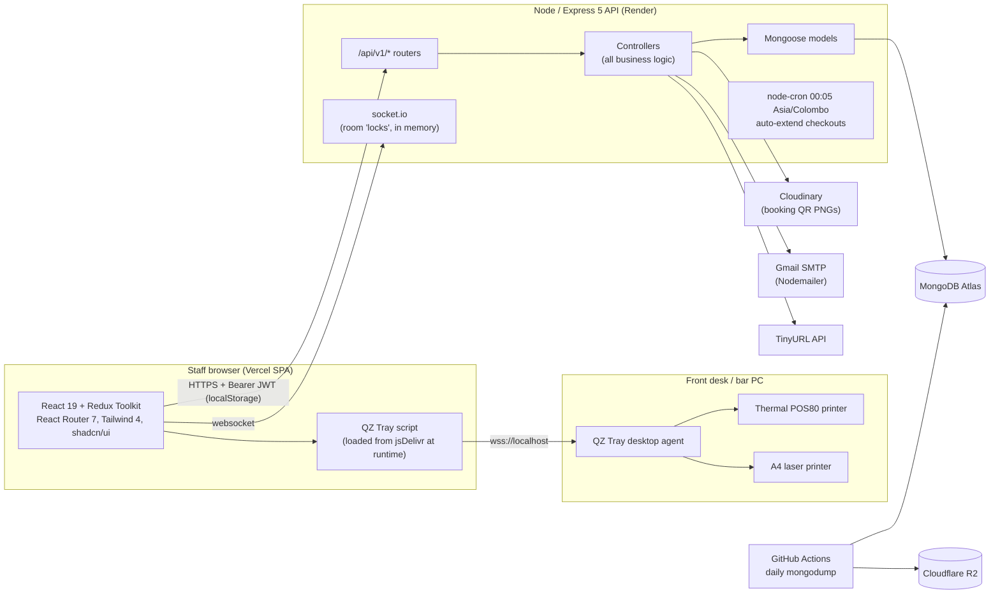
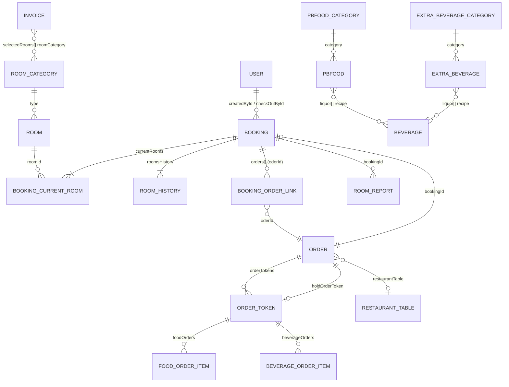
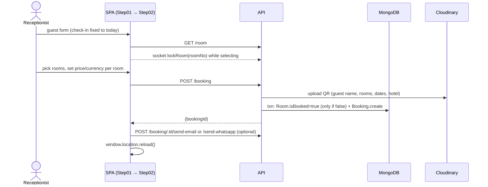
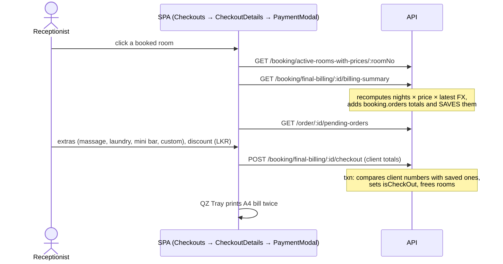
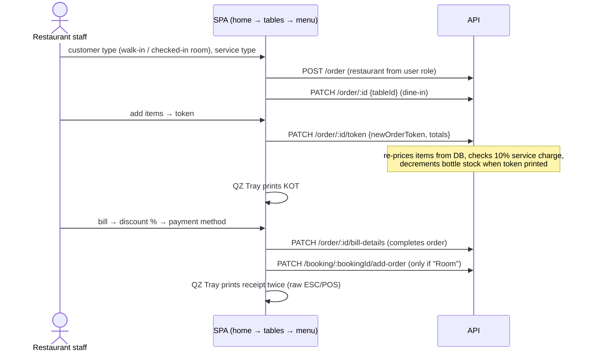

# 01 · System Overview

How the Ganesh Garden Hotel system is put together today: architecture, modules, data model, every API endpoint
and every frontend route. This is a description of what exists, not a recommendation; findings live in
documents 02–05.

---

## 1. Architecture at a glance

- **Monorepo, two packages:** `backend/` (Express, ES modules, no build step) and `frontend/` (Vite + TS).
- **Layering:** `routes → controllers → models`. There is no service layer, no repository layer, no central error
  handler, no request validation middleware and no tests.
- **Auth model:** JWT access token (3 h) returned in the login JSON and stored by the SPA in `localStorage`; a
  refresh token (30 d JWT, bcrypt-hashed in the user document) is set as an `httpOnly; Secure; SameSite=Strict`
  cookie, but the SPA never calls the refresh endpoint. Logout blacklists the access token (TTL collection).
- **Realtime:** a single socket.io namespace that broadcasts `roomLocked` / `roomUnlocked` while a receptionist
  is selecting rooms. Locks are advisory and kept in process memory.
- **Scheduled work:** one cron job inside the web process; one GitHub Actions workflow for backups.

## 2. Code size (tracked source, excluding lockfiles and images)

| Area | Files | Lines (approx.) | Largest files |
|---|---|---|---|
| Backend | 76 `.js` | ~10,750 | `order-controller.js` 2,251 · `booking-controller.js` 1,981 · `beverageController.js` 719 · `total-bill-calculation-controller.js` 690 |
| Frontend | 227 in `src/` | ~22,900 (two print utilities are mostly an inline base64 logo) | `orderSlice.ts` 560 · `BookingUpdate.tsx` 566 · `InvoiceForm.tsx` 498 · `Step01.tsx` 497 · `Login.tsx` 442 |

Roughly 30 % of the two largest backend controllers (1,289 of 4,232 lines) is commented-out code.

## 3. Business modules

| Module | Who uses it | Backend | Frontend |
|---|---|---|---|
| Authentication & users | everyone / admins | `auth-controller`, `user-controller`, `routes/Admin/*` | `pages/login`, `component/authentication`, `pages/admin/UserConfig` |
| Reception — check-in | Reception | `booking-controller.createBooking`, `utils/qr.js`, socket | `pages/reception/onboarding` (`Step01`, `Step02`), `component/room/*` |
| Reception — bookings & room switch | Reception | `updateBooking`, `switchRoomsBulk`, lists | `pages/reception/bookings`, `switch_rooms`, `room_availability` |
| Reception — checkout & final bill | Reception | `total-bill-calculation-controller` | `pages/reception/checkouts`, `component/checkout/*`, `util/printCheckout.ts` |
| Reception — proforma invoices | Reception | `invoice-controller` | `pages/reception/invoice`, `component/invoice/*`, `util/printInvoice.ts` |
| Restaurants (Beach & Pool POS) | Restaurant staff/admins | `order-controller`, `pbfoodnet*`, `extra-beverage-controller` | `pages/beach-restaurant/*`, `component/beach-&-pool-restaurant/*`, `features/beach-restaurant/*` |
| Beverage inventory | Admins | `beverageController`, `utils/beverageStock.js` | `pages/admin/beverage_inventory/*`, `component/beverage-inventory/*` |
| Currency rates | Admins | `currency-value-controller` | `pages/admin/CurrencyConfig`, `component/admin/CurrencyConverter` |
| Reports | Reception / Admins | `Excel/room-report`, `hotelDashboardController`, order summaries | `pages/admin/Reports`, `component/reports/*`, restaurant summary pages |

## 4. Data model

| Collection (model) | Purpose | Notable fields | Indexes / constraints |
|---|---|---|---|
| `users` (User) | staff accounts | `email` (unique), `password` (bcrypt of 4-digit PIN), `userRole` (enum), `isActive`, `refreshToken` (bcrypt), `tempPassword`, `tempPasswordExpires` | `email` unique |
| `blacklistedtokens` | revoked access tokens | `token`, `expireAt` | TTL on `expireAt`; no index on `token` |
| `rooms` (Room) | physical rooms | `no` (unique), `type`→RoomCategory, `perDayPrice`, `currency`, `facilities[]`, `isBooked`, `isMaintenance` | `no` unique. No `hotel` field |
| `roomcategories` | room types | `type` | none (duplicates prevented in code only) |
| `bookings` (Booking) | a stay | `hotel` (enum of 2), `uniqueBookingId` (`bookingYYYYMMDD####`), guest data, `checkIn/checkOut`, `currentRooms[]`, `roomsHistory[]` (per-room price, currency, nights, switch dates), bill fields (`subtotal`, `tax`, `discount`, `miniBar`, `laundary`, `spa`, `totalBill`…), `orders[] {oderId, date}`, `isCheckOut`, cron fields, QR `qrUrl` | `uniqueBookingId` unique; `{isCheckOut, checkOut}`; `{lastExtendedOn, isCheckOut}` |
| `counters` | daily booking sequence | `dateKey`, `sequenceValue` | `dateKey` unique |
| `invoices` (Invoice) | proforma / quotation invoices | `invoiceNumber` (`INV-000001`), dates, `hotelType`, `currencyType`, `selectedRooms[]`, `total` (Decimal128) | none (`invoiceNumber` not unique) |
| `invoicecounters` | invoice sequence | `name`, `seq` | `name` uniqueness commented out |
| `orders` (Order) | a restaurant ticket | `orderNumber`, `customerType`, `serviceType`, `restaurantType`, `roomNumber`, `guestName`, `bookingId`, `restaurantTable`, `orderStatus` (1–6), `orderTokens[]`, `holdOrderToken`, money fields, `paymentMethod`, `checkOutUser` | none |
| `ordertokens` (OrderToken) | one KOT / round of items | `tokenId`, `tokenNumber`, `foodOrders[]`, `beverageOrders[]`, `isPrinted`, token totals | none |
| `foodorderitems`, `beverageorderitems` | line items | `foodId`/`beverageId` (String), `title`, `quantity`, `price`, `liquor[]`, `restaurantType` | none |
| `ordercounters` | order sequence per restaurant | `restaurantType` (unique), `seq` | unique |
| `restauranttables` | tables | `name`, `tableNumber`, `restaurantType`, `status` | none |
| `pbfoodnets`, `pbfoodnetcategories` | food menu per restaurant | `itemName`, `price`, `category`, `isVisible`, `liquor[]` | none |
| `extrabeverages`, `extrabeveragecategories` | cocktails/other drinks | `price`, `liquor[]`, `isVisible`, `restaurantType` (category) | `beverageName`; `{extraBeverageCategory, isVisible}` |
| `beverages` (Beverage) | bottle stock | `beverageName`, `price`, `runningStock`, `category` (`hard liquor`/`soft drinks`), `volume`, `historyQuantity[]`, `historyVolumeForPBFoodNet[]` | index on non-existent `history.year/month` |
| `currencyvalues` | daily FX | `usd`, `eur` (LKR per unit), `effectiveAt` | `effectiveAt` desc |
| `roomreports` | finance room report rows | booking/room/price/commission/service charge/net | none |

Order status values: `1` initial data set · `2` preparing · `3` ready · `4` served · `5` completed · `6` canceled
(only 1, 5 and 6 are written by current code).

## 5. Key flows

### 5.1 Check-in (onboarding)

### 5.2 Hotel checkout

### 5.3 Restaurant order (Beach / Pool)

## 6. API inventory (109 endpoints)

"Auth (JWT)" = `authenticateToken` present. "Roles" = `authorizeRoles([...])`. Generated from the route files and
the mounts in `server.js`; commented-out middleware was treated as absent.

**Totals:** 109 endpoints · 68 have no JWT check · of those, 4 are legitimately public (`login`,
`forgot-password`, `reset-password`, `refresh-token`) and **64 should not be** · 31 of the unauthenticated
endpoints are non-GET (including `POST /auth/register`); 28 of those write to the database
(`POST /booking/get-all-active-bookings` is a read, and `send-whatsapp`/`send-email` only have external side
effects) · 7 more require a token but accept any role.

| # | Method | Path | Auth (JWT) | Blacklist check | Roles | Handler |
|---|---|---|---|---|---|---|
| 1 | POST | `/api/v1/auth/register` | **NO** | no | **public** | `registerNewUser` |
| 2 | POST | `/api/v1/auth/login` | **NO** | no | **public** | `loginUser` |
| 3 | POST | `/api/v1/auth/logout` | yes | yes | any authenticated | `logoutUser` |
| 4 | POST | `/api/v1/auth/refresh-token` | **NO** | yes | **public** | `refreshUserTokens` |
| 5 | POST | `/api/v1/auth/forgot-password` | **NO** | no | **public** | `forgotPassword` |
| 6 | POST | `/api/v1/auth/reset-password` | **NO** | no | **public** | `resetPassword` |
| 7 | GET | `/api/v1/user` | yes | yes | Super-Admin | `getAllUsers` |
| 8 | GET | `/api/v1/user/user-role` | yes | yes | any authenticated | `getUserRole` |
| 9 | GET | `/api/v1/user/details` | yes | yes | any authenticated | `getUserById` |
| 10 | POST | `/api/v1/booking` | yes | no | any authenticated | `createBooking` |
| 11 | PUT | `/api/v1/booking/:bookingId/switch-rooms` | **NO** | no | **public** | `switchRoomsBulk` |
| 12 | POST | `/api/v1/booking/:id/send-whatsapp` | **NO** | no | **public** | `sendBookingQrViaWhatsApp` |
| 13 | POST | `/api/v1/booking/:id/send-email` | **NO** | no | **public** | `sendBookingQrViaEmail` |
| 14 | GET | `/api/v1/booking/active-rooms-with-prices/:roomNo` | **NO** | no | **public** | `getBookingWithActiveRoomsAndPrices` |
| 15 | GET | `/api/v1/booking/details/all-rooms` | **NO** | no | **public** | `getAllRoomsWithBookingDetails` |
| 16 | GET | `/api/v1/booking/extended-today` | **NO** | no | **public** | `getTodayExtendedRooms` |
| 17 | GET | `/api/v1/booking/details/reserved-all-rooms` | **NO** | no | **public** | `getAllReservedRoomsWithBookingDetails` |
| 18 | PATCH | `/api/v1/booking/:id/add-order` | **NO** | no | **public** | `addOrderToBooking` |
| 19 | PUT | `/api/v1/booking/:id/update-booking` | yes | no | any authenticated | `updateBooking` |
| 20 | POST | `/api/v1/booking/get-all-active-bookings` | **NO** | no | **public** | `getAllActiveBookings` |
| 21 | GET | `/api/v1/booking/get-booking/:id` | **NO** | no | **public** | `getBookingById` |
| 22 | GET | `/api/v1/booking/specific/details/:id` | **NO** | no | **public** | `getSpecificBookingDetails` |
| 23 | GET | `/api/v1/booking/completed` | **NO** | no | **public** | `getCompletedBookings` |
| 24 | GET | `/api/v1/booking/completed/:id` | **NO** | no | **public** | `getBookingByIdIfCheckedOut` |
| 25 | GET | `/api/v1/booking/final-billing/:id/billing-summary` | yes | no | any authenticated | `getBookingBillingSummary` |
| 26 | POST | `/api/v1/booking/final-billing/:id/checkout` | yes | no | any authenticated | `finalizeBookingBill` |
| 27 | POST | `/api/v1/invoice` | yes | yes | Admin, Reception, Super-Admin | `generateInvoice` |
| 28 | POST | `/api/v1/invoice/reset-counter` | yes | yes | Admin, Reception, Super-Admin | `resetInvoiceCounter` |
| 29 | GET | `/api/v1/invoice` | yes | yes | Admin, Reception, Super-Admin | `getInvoices` |
| 30 | GET | `/api/v1/invoice/:id` | yes | yes | Admin, Reception, Super-Admin | `getInvoiceById` |
| 31 | POST | `/api/v1/room` | **NO** | no | **public** | `addRoom` |
| 32 | GET | `/api/v1/room/available` | **NO** | no | **public** | `getAvailableAllRooms` |
| 33 | GET | `/api/v1/room` | **NO** | no | **public** | `getAllRooms` |
| 34 | PUT | `/api/v1/room/update/:id` | **NO** | no | **public** | `updateRoom` |
| 35 | POST | `/api/v1/room/room-category` | **NO** | no | **public** | `createRoomCategory` |
| 36 | GET | `/api/v1/room/room-category` | **NO** | no | **public** | `getAllRoomCategories` |
| 37 | GET | `/api/v1/room/room-category/:id` | **NO** | no | **public** | `getRoomCategoryById` |
| 38 | PUT | `/api/v1/room/room-category/:id` | **NO** | no | **public** | `updateRoomCategory` |
| 39 | DELETE | `/api/v1/room/room-category/:id` | **NO** | no | **public** | `deleteRoomCategory` |
| 40 | POST | `/api/v1/order` | yes | yes | Admin, Beach-Admin, Beach-Staff, Pool-Admin, Pool-Staff, Super-Admin | `setInitialOrderDetails` |
| 41 | POST | `/api/v1/order/table` | yes | yes | Admin, Beach-Admin, Beach-Staff, Pool-Admin, Pool-Staff, Super-Admin | `addTable` |
| 42 | GET | `/api/v1/order/table` | yes | yes | Admin, Beach-Admin, Beach-Staff, Pool-Admin, Pool-Staff, Super-Admin | `getAllTables` |
| 43 | GET | `/api/v1/order/table/:id` | yes | yes | Admin, Beach-Admin, Beach-Staff, Pool-Admin, Pool-Staff, Super-Admin | `getTableById` |
| 44 | PATCH | `/api/v1/order/table/:id` | yes | yes | Admin, Beach-Admin, Beach-Staff, Pool-Admin, Pool-Staff, Super-Admin | `updateTable` |
| 45 | PATCH | `/api/v1/order/:id` | yes | yes | Admin, Beach-Admin, Beach-Staff, Pool-Admin, Pool-Staff, Super-Admin | `selectTableForOrder` |
| 46 | PATCH | `/api/v1/order/:id/token` | yes | yes | Admin, Beach-Admin, Beach-Staff, Pool-Admin, Pool-Staff, Super-Admin | `addOrderToken` |
| 47 | PATCH | `/api/v1/order/:id/bill-details` | yes | yes | Admin, Beach-Admin, Beach-Staff, Pool-Admin, Pool-Staff, Super-Admin | `updateOrderBillDetails` |
| 48 | GET | `/api/v1/order/hold-orders` | yes | yes | Admin, Beach-Admin, Beach-Staff, Pool-Admin, Pool-Staff, Super-Admin | `getHoldOrders` |
| 49 | GET | `/api/v1/order/daily-summary` | yes | yes | Admin, Beach-Admin, Beach-Staff, Pool-Admin, Pool-Staff, Super-Admin | `getDailyOrdersSummary` |
| 50 | GET | `/api/v1/order/order-summary` | yes | yes | Admin, Super-Admin | `getOrderSummary` |
| 51 | GET | `/api/v1/order/beverage/sold-summary` | **NO** | no | **public** | `getBeverageSoldSummary` |
| 52 | GET | `/api/v1/order/beverage/sold/liquor-summary` | **NO** | no | **public** | `getLiquorSummaryForOtherItems` |
| 53 | GET | `/api/v1/order/:id` | yes | yes | Admin, Beach-Admin, Beach-Staff, Pool-Admin, Pool-Staff, Super-Admin | `getOrderDetails` |
| 54 | PATCH | `/api/v1/order/:id/cancel` | yes | yes | Admin, Beach-Admin, Beach-Staff, Pool-Admin, Pool-Staff, Super-Admin | `cancelOrder` |
| 55 | GET | `/api/v1/order/restaurant/summary` | yes | yes | Admin, Beach-Admin, Beach-Staff, Pool-Admin, Pool-Staff, Super-Admin | `getDailyRestaurantTotals` |
| 56 | GET | `/api/v1/order/restaurant/excel-report` | yes | yes | Admin, Beach-Admin, Beach-Staff, Pool-Admin, Pool-Staff, Super-Admin | `exportRestaurantSummaryExcel` |
| 57 | GET | `/api/v1/order/:bookingId/pending-orders` | yes | yes | Admin, Beach-Admin, Pool-Admin, Reception, Super-Admin | `checkPendingOrdersForBooking` |
| 58 | POST | `/api/v1/pbfoodcategories` | yes | yes | Admin, Beach-Admin, Pool-Admin | `createCategory` |
| 59 | PUT | `/api/v1/pbfoodcategories/:id` | **NO** | no | **public** | `updateCategory` |
| 60 | DELETE | `/api/v1/pbfoodcategories/:id` | **NO** | no | **public** | `deleteCategory` |
| 61 | GET | `/api/v1/pbfoodcategories` | yes | yes | Admin, Beach-Admin, Beach-Staff, Pool-Admin, Pool-Staff | `getCategories` |
| 62 | GET | `/api/v1/pbfoodcategories/available` | yes | yes | Admin, Beach-Admin, Beach-Staff, Pool-Admin, Pool-Staff | `getAvailableCategories` |
| 63 | GET | `/api/v1/pbfoodcategories/:id` | **NO** | no | **public** | `getCategory` |
| 64 | POST | `/api/v1/beverages` | **NO** | no | **public** | `createBeverage` |
| 65 | GET | `/api/v1/beverages` | **NO** | no | **public** | `getAllBeverages` |
| 66 | GET | `/api/v1/beverages/special/details` | **NO** | no | **public** | `getAllBeveragesWithMinimalDetails` |
| 67 | GET | `/api/v1/beverages/categories/summary` | **NO** | no | **public** | `getCategorySummary` |
| 68 | GET | `/api/v1/beverages/:id` | **NO** | no | **public** | `getOneBeverage` |
| 69 | PUT | `/api/v1/beverages/price-and-volume/:id` | **NO** | no | **public** | `updateBeveragePriceAndVolume` |
| 70 | PUT | `/api/v1/beverages/reduce-beverage-quantity/:id` | **NO** | no | **public** | `reduceBeverageQuantity` |
| 71 | PUT | `/api/v1/beverages/add-beverage-quantity/:id` | **NO** | no | **public** | `addBeverageQuantity` |
| 72 | DELETE | `/api/v1/beverages/:id` | **NO** | no | **public** | `deleteBeverage` |
| 73 | POST | `/api/v1/pbfoodnets` | yes | yes | Admin, Beach-Admin, Pool-Admin | `createPBFoodNet` |
| 74 | GET | `/api/v1/pbfoodnets` | yes | yes | Admin, Beach-Admin, Beach-Staff, Pool-Admin, Pool-Staff | `getPBFoodNets` |
| 75 | GET | `/api/v1/pbfoodnets/available` | yes | yes | Admin, Beach-Admin, Beach-Staff, Pool-Admin, Pool-Staff | `getAvailablePBFoodNets` |
| 76 | GET | `/api/v1/pbfoodnets/:id` | **NO** | no | **public** | `getPBFoodNet` |
| 77 | PATCH | `/api/v1/pbfoodnets/:id` | **NO** | no | **public** | `updatePBFoodNet` |
| 78 | DELETE | `/api/v1/pbfoodnets/:id` | **NO** | no | **public** | `deletePBFoodNet` |
| 79 | GET | `/api/v1/pbfoodnets/:id/available` | **NO** | no | **public** | `getAvailablePBFoodNet` |
| 80 | POST | `/api/v1/extra-beverages/category` | yes | yes | Admin, Beach-Admin, Pool-Admin | `createExtraBeverageCategory` |
| 81 | GET | `/api/v1/extra-beverages/available/category` | yes | yes | Admin, Beach-Admin, Beach-Staff, Pool-Admin, Pool-Staff | `getAvailableExtraBeverageCategories` |
| 82 | GET | `/api/v1/extra-beverages/category` | **NO** | no | **public** | `listExtraBeverageCategories` |
| 83 | GET | `/api/v1/extra-beverages/category/:id` | **NO** | no | **public** | `getExtraBeverageCategory` |
| 84 | PUT | `/api/v1/extra-beverages/category/:id` | **NO** | no | **public** | `updateExtraBeverageCategory` |
| 85 | DELETE | `/api/v1/extra-beverages/category/:id` | **NO** | no | **public** | `deleteExtraBeverageCategory` |
| 86 | PATCH | `/api/v1/extra-beverages/category/:id/toggle-visibility` | **NO** | no | **public** | `toggleExtraBeverageCategoryVisibility` |
| 87 | GET | `/api/v1/extra-beverages/available` | **NO** | no | **public** | `getAvailableExtraBeverages` |
| 88 | POST | `/api/v1/extra-beverages` | **NO** | no | **public** | `createExtraBeverage` |
| 89 | GET | `/api/v1/extra-beverages` | **NO** | no | **public** | `listExtraBeverages` |
| 90 | GET | `/api/v1/extra-beverages/:id` | **NO** | no | **public** | `getExtraBeverage` |
| 91 | PUT | `/api/v1/extra-beverages/:id` | **NO** | no | **public** | `updateExtraBeverage` |
| 92 | DELETE | `/api/v1/extra-beverages/:id` | **NO** | no | **public** | `deleteExtraBeverage` |
| 93 | PATCH | `/api/v1/extra-beverages/:id/toggle-visibility` | **NO** | no | **public** | `toggleExtraBeverageVisibility` |
| 94 | POST | `/api/v1/admin/create-user` | yes | yes | Admin, Super-Admin | `registerNewUser` |
| 95 | GET | `/api/v1/admin/get-users` | yes | yes | Admin, Super-Admin | `getAllUsers` |
| 96 | GET | `/api/v1/admin/get-user/:id` | yes | yes | Admin, Super-Admin | `getUserById` |
| 97 | PATCH | `/api/v1/admin/deactivate-user/:id` | yes | yes | Admin, Super-Admin | `deleteUserById` |
| 98 | PATCH | `/api/v1/admin/activate-user/:id` | yes | yes | Admin, Super-Admin | `activateUserById` |
| 99 | POST | `/api/v1/currency-values` | **NO** | no | **public** | `upsertTodayCurrencyValues` |
| 100 | GET | `/api/v1/currency-values/latest` | **NO** | no | **public** | `getLatestCurrencyValues` |
| 101 | GET | `/api/v1/currency-values` | **NO** | no | **public** | `listCurrencyValues` |
| 102 | GET | `/api/v1/currency-values/:id` | **NO** | no | **public** | `getCurrencyValueById` |
| 103 | PUT | `/api/v1/currency-values/:id` | **NO** | no | **public** | `updateCurrencyValueById` |
| 104 | DELETE | `/api/v1/currency-values/:id` | **NO** | no | **public** | `deleteCurrencyValueById` |
| 105 | GET | `/api/v1/hotel-dashboard/monthly-summary` | **NO** | no | **public** | `getMonthlySummary` |
| 106 | GET | `/api/v1/hotel-dashboard/monthly-guests` | **NO** | no | **public** | `getMonthlyGuestRegistrations` |
| 107 | GET | `/api/v1/reports` | **NO** | no | **public** | `getBookingAndRoomReports` |
| 108 | POST | `/api/v1/reports` | **NO** | no | **public** | `saveRoomReports` |
| 109 | GET | `/api/v1/reports/export` | **NO** | no | **public** | `exportRoomReportsToExcel` |

## 7. Frontend route map

All routes except `/` sit under one `<ProtectedRoute>` that only checks that *some* token exists in
`localStorage`. Which role "owns" a page is decided only by the sidebar configuration in `Layout/Layout.tsx`.

| Path | Page | Intended role(s) (from sidebar) |
|---|---|---|
| `/` | `Login` | public |
| `/onboarding` | `Onboarding` (`Step01` guest form → `Step02` room picker) | Reception (Admins via "Reception") |
| `/room-availability` | `RoomAvailability` | Reception |
| `/bookings` · `/bookings/:id` | `Bookings` · `BookingUpdate` | Reception |
| `/switch-rooms` | `SwitchRooms` | Reception |
| `/checkouts` · `/checkout-details` · `/completed-checkout-details` | `Checkouts` · `CheckoutDetails` · `CheckoutCompletedDetails` | Reception |
| `/invoice` | `Invoice` (proforma invoices) | Reception |
| `/reports` | `Reports` (room reports) | Reception |
| `/room-config` | `RoomConfig` | none (Reception link commented out) |
| `/restaurant/home` | `BeachRestaurantHomePage` (used for Pool too) | Restaurant staff/admins |
| `/restaurant/tables/:id` · `/restaurant/menu/:id` | tables · menu/ordering | Restaurant staff/admins |
| `/restaurant/hold` · `/restaurant/daily-summary` | hold orders · daily summary | Restaurant staff/admins |
| `/restaurant/report` | `RestaurantSummaryPage` | Restaurant admins |
| `/beverage-inventory/dashboard` · `/beverage-inventory/manage-inventory` | inventory | Admin, Super-Admin |
| `/admin/dashboard` | `AdminDashboard` | Admin, Super-Admin |
| `/admin/currency-config` · `/admin/user-config` · `/admin/room-config` | config pages | Admin, Super-Admin |
| `/admin/reports` · `/admin/restaurant/reports` | reports | Admin, Super-Admin |
| — | `pages/admin/PrinterDiagnostics.tsx` | **not routed** (unreachable) |
| `*` | — | **no 404 route** (blank layout) |

## 8. Redux store

`user` (role, restaurantType) · `auth` (forgot-password modal) · `onboarding` (step, guest form, selected rooms) ·
`booking` (room → active booking lookup) · `rooms` (selected room numbers) · `removedRooms` (switch flow) ·
`invoice` · `order` (current restaurant order, tokens, totals, modal flags) · `food`, `foodCategory`,
`beverage`, `beverageCategory` (menus) · `holdOrder` · `dailyOrderSummary` · `restaurantSummary`.
Two React contexts sit beside Redux: `RateContext` (FX) and `CurrencyContext` (display currency, always LKR
because the dropdown is commented out). Nothing is persisted except the access token in `localStorage`.

## 9. External services & configuration

| Service | Used for | Where |
|---|---|---|
| MongoDB Atlas | primary database (transactions require a replica set — Atlas provides it) | `config/db-config.js` |
| Cloudinary | public PNG of each booking's QR code | `utils/qr.js`, `utils/cloudinary.js` |
| Gmail SMTP | booking confirmation e-mails, temporary passwords | `booking-controller.sendEmailMessage`, `utils/auth-util.js` |
| wa.me + TinyURL | WhatsApp deep link containing the shortened QR URL (no message is actually sent by the server) | `utils/sendWhatsAppMessage.js` |
| QZ Tray | printing from the browser to local thermal/A4 printers | `util/printerConfig.ts`, `util/print*.ts`, several components |
| Cloudflare R2 | daily `mongodump --db production` archive | `.github/workflows/google-drive-backup.yml` |
| Render / Vercel | hosting (inferred from configured origins and `vercel.json`) | `.env`, `vercel.json` |
